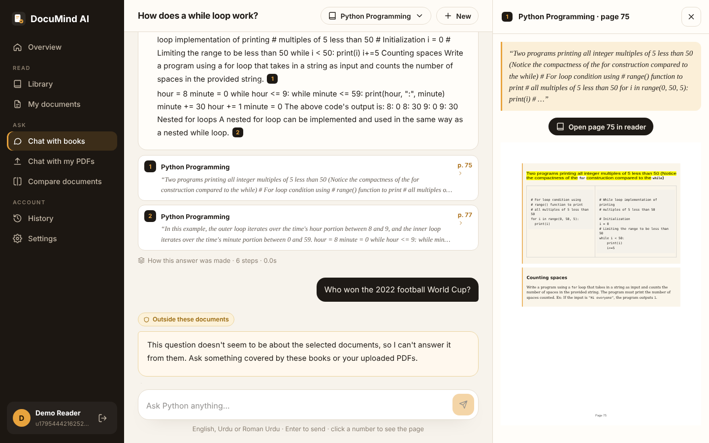
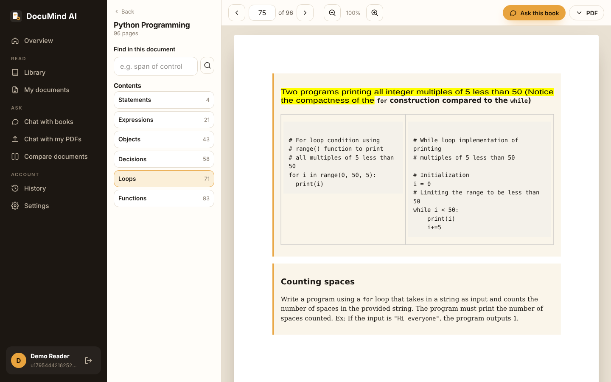
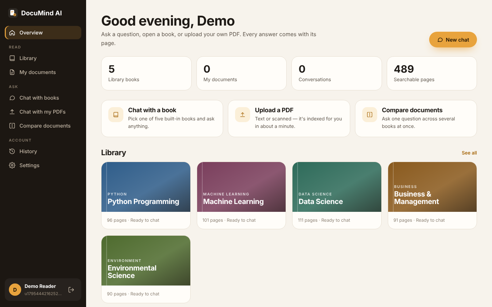
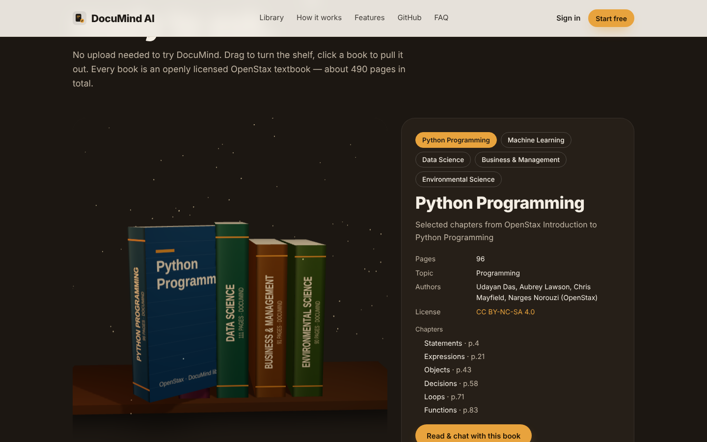
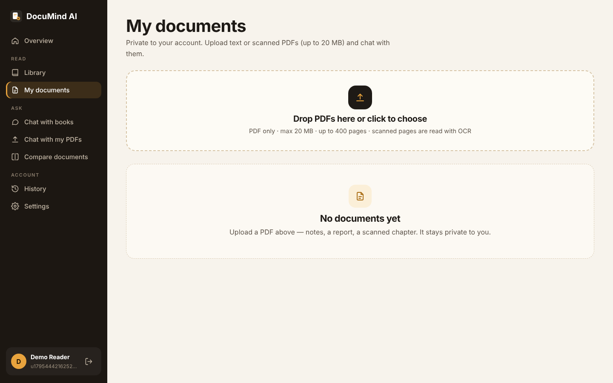
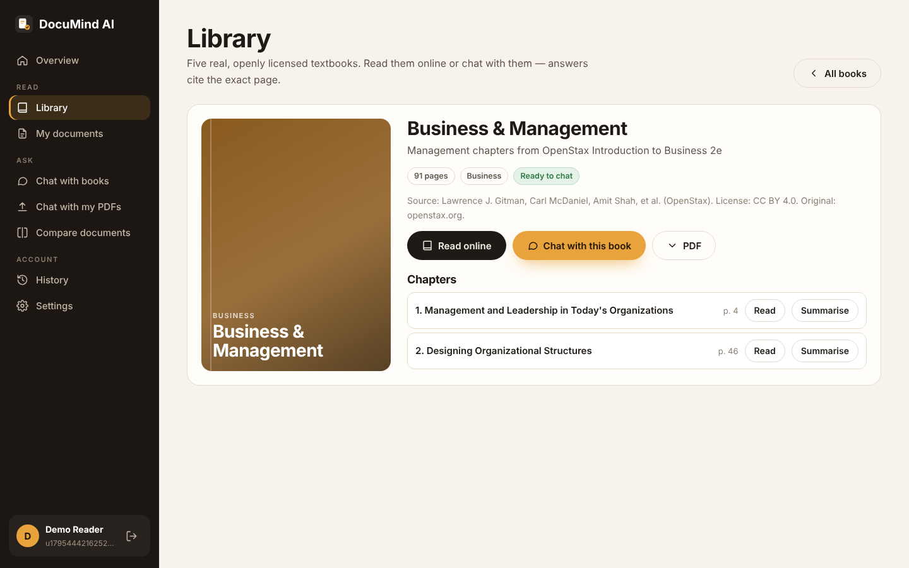
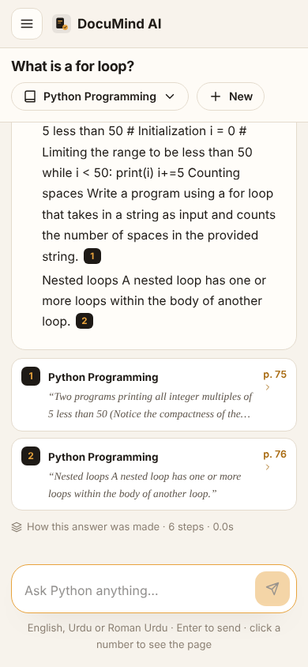
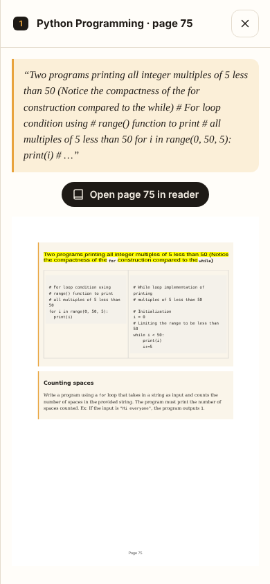
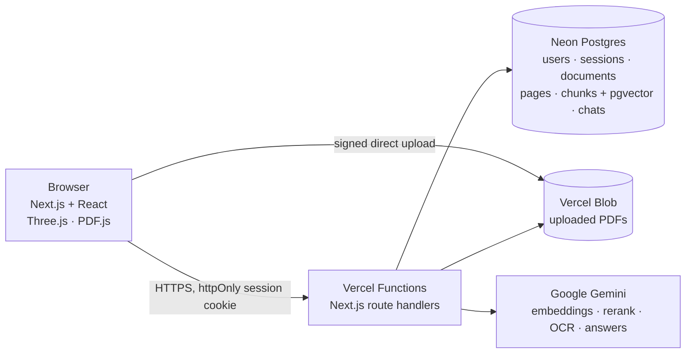
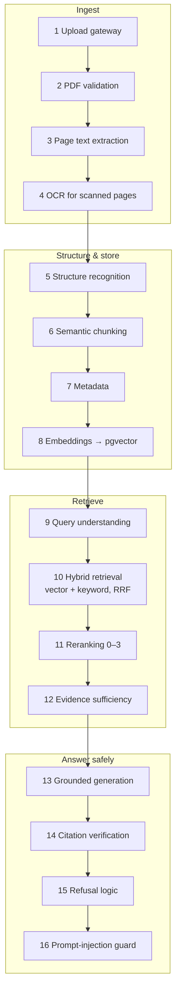

<div align="center">

# DocuMind AI

**Ask your documents. Get answers you can prove.**

An advanced RAG (Retrieval-Augmented Generation) platform: chat with built-in books and your own PDFs, get answers with page-level citations, and an honest refusal when the evidence isn't there.

<!-- LIVE_LINK -->

    

</div>

<!-- HERO_SCREENSHOT -->

## What it does

| | |
|---|---|
| 📚 **Built-in library** | Five openly licensed textbooks (Python, Machine Learning, Data Science, Business, Environmental Science — 489 pages). Read them online or chat with them, no upload needed. |
| 📄 **Your own PDFs** | Upload text or scanned PDFs (up to 20 MB). Scanned pages are read with OCR. Uploads are private to your account. |
| 🔎 **Page-level citations** | Every claim carries a numbered citation. Click it to see the quote and the exact PDF page, highlighted. |
| 🛑 **Refusal logic** | No answer is invented. DocuMind refuses when the answer is absent, the evidence is weak, sources conflict, the question is unrelated, or a document tries to inject instructions. |
| ⚖️ **Multi-document comparison** | Ask one question across up to six books and PDFs; evidence is balanced per document. |
| 🧾 **Chapter summaries** | "Summarise the chapter *Functions*" retrieves only that chapter's page range. |
| 🌐 **Languages** | Ask in English, Urdu or Roman Urdu; the answer comes back in the same language, still cited. |
| 👤 **Accounts** | Sign up / sign in, hashed passwords, server-side sessions, per-user data isolation, chat history, reading progress. |

## Screenshots

| Chat with clickable citations | PDF reader |
|---|---|
|  |  |
| **Dashboard** | **Interactive 3D library** |
|  |  |
| **My documents** | **Book detail & chapter summaries** |
|  |  |

<p align="center">&nbsp;&nbsp;</p>

## Architecture

Everything runs on **Vercel**: the Next.js frontend, the API (route handlers as serverless functions), **Neon Postgres** (Vercel Marketplace) for data and vectors, and **Vercel Blob** for uploaded PDFs. Nothing permanent is stored on the serverless filesystem.



### The 16-stage RAG pipeline



| Stage | How it's done |
|---|---|
| Validation | Real PDF signature, empty / oversized / encrypted / corrupt files rejected with clear messages; 400-page limit |
| Extraction & OCR | `unpdf` per page with original page numbers; if most pages have no text, Gemini reads them (OCR) |
| Chunking | Sentence-based chunks (~1,100 chars, 1-sentence overlap) that never cross a page, carrying the current section heading; photo credits and ligatures cleaned |
| Indexing | `gemini-embedding-001` (768-d) in pgvector with an HNSW cosine index, plus a Postgres full-text (`tsvector`, GIN) index |
| Query understanding | Rewrites follow-ups into standalone questions, detects language, intent (Q&A / summary / compare), chapter and whether the question is related |
| Retrieval | Vector and keyword results fused with Reciprocal Rank Fusion; balanced per document for comparisons; page-range filter for chapter summaries |
| Reranking & sufficiency | The model scores each passage 0–3; if nothing scores ≥ 2, the system refuses before generating |
| Generation | The model may only use numbered `<passage>` evidence and must cite `[n]`; document text is treated as data, never as instructions |
| Citation verification | Each cited claim is checked against its passage; unverifiable citations are dropped and renumbered; no verified citation → refusal |

The steps and their timings are shown under every answer ("How this answer was made").

## Tech stack

- **Frontend:** Next.js 15 (App Router), React 19, React Three Fiber / drei (3D library), react-pdf (PDF.js), react-markdown
- **Backend:** Next.js route handlers on Vercel serverless (Node.js runtime), Zod validation, structured JSON logs
- **Database:** Neon Postgres + pgvector, Drizzle ORM, SQL migrations run during the Vercel build
- **Storage:** Vercel Blob (client uploads with short-lived tokens)
- **AI:** Google Gemini (`gemini-3.5-flash-lite`, `gemini-embedding-001`)
- **Auth:** bcrypt (cost 11), signed JWT in an httpOnly cookie backed by a server-side session table, rate-limited sign-in and chat
- **Tests:** Vitest with an in-memory Postgres (PGlite + pgvector) running the real migrations

## Security & privacy

- Passwords hashed with bcrypt; sessions are revocable server-side; cookies are `httpOnly`, `secure`, `sameSite=lax`
- Every document, chunk, conversation and reading-progress query is scoped to the signed-in user; other users' IDs return 404
- Uploads only go to the user's own Blob folder and are registered only if the URL matches it
- Prompt-injection patterns in documents are flagged, and the model is instructed never to follow document instructions
- Secrets live only in Vercel environment variables (see `.env.example`); nothing secret is in the repository

## Evaluation

`data/eval.json` holds 25 questions with known answer pages across the five books, plus 5 unanswerable questions.
`GET /api/admin/eval?refusal=1` (admin token) measures **Recall@K, Precision@K and MRR** for hybrid, vector-only and keyword-only retrieval, and checks that unanswerable questions are refused. `node scripts/eval.mjs` saves the results to `notebooks/eval-results.json`, and `notebooks/evaluation.ipynb` charts them.

<!-- EVAL_RESULTS -->

## Tests

```bash
npm test        # 52 tests: unit, auth, API, upload validation, retrieval, citations, refusals, multi-PDF, isolation
npm run typecheck
```

The tests use an in-memory Postgres with pgvector and a deterministic stand-in for the AI model, so they run offline.

## Run it yourself

```bash
git clone https://github.com/Haniya-Imran/documind-ai.git
cd documind-ai
npm install
cp .env.example .env.local   # fill in DATABASE_URL, AUTH_SECRET, GEMINI_API_KEY, BLOB_READ_WRITE_TOKEN, ADMIN_TOKEN
node scripts/migrate.mjs
npm run dev
```

Then index the built-in library once: `curl -X POST "http://localhost:3000/api/admin/seed" -H "x-admin-token: $ADMIN_TOKEN"` (repeat until it reports `"done": true`).

**Offline preview:** `AUTH_SECRET=... ADMIN_TOKEN=... node scripts/local-preview.mjs` (after `npm run build`) runs the whole app with an embedded Postgres and a keyword-based stand-in instead of Gemini — handy for UI work, but its answers are not real AI answers.

### Deploying on Vercel

1. Import the repository in Vercel (framework: Next.js; the `vercel-build` script runs database migrations).
2. Add **Neon** from the Vercel Marketplace and create a **Blob** store — both add their environment variables automatically.
3. Add `AUTH_SECRET`, `ADMIN_TOKEN` and `GEMINI_API_KEY` in Project → Settings → Environment Variables.
4. Deploy, then call `/api/admin/seed` with the admin token until all five books are ready.

## Project structure

```
src/
  app/            pages (landing, auth, dashboard, chat, reader) and api/ route handlers
  components/     landing (hero, 3D shelf), app shell, chat, PDF viewer
  lib/
    rag/          extract, chunker, provider (Gemini), retrieve, answer, citations, ingest, metrics
    auth/         password hashing, sessions, account service
    db/           Drizzle schema and client
data/             library metadata, per-page book text, evaluation set
drizzle/          SQL migrations
public/books/     the five library PDFs
scripts/          migrate, eval, local preview, book builder
tests/            Vitest suites + PDF fixtures
notebooks/        evaluation notebook
```

## Credits & licenses

- Library books are compiled from **OpenStax** textbooks (Introduction to Python Programming; Principles of Data Science; Introduction to Business 2e; Biology 2e), used under their Creative Commons licenses (CC BY 4.0 / CC BY-NC-SA 4.0). Each book's license and source are shown in the app. The Machine Learning and Data Science books are both drawn from *Principles of Data Science*. NC-licensed content is for non-commercial use.
- Landing-page photos from Unsplash (credited in the site footer).

---

Built by **Haniya Imran**.
